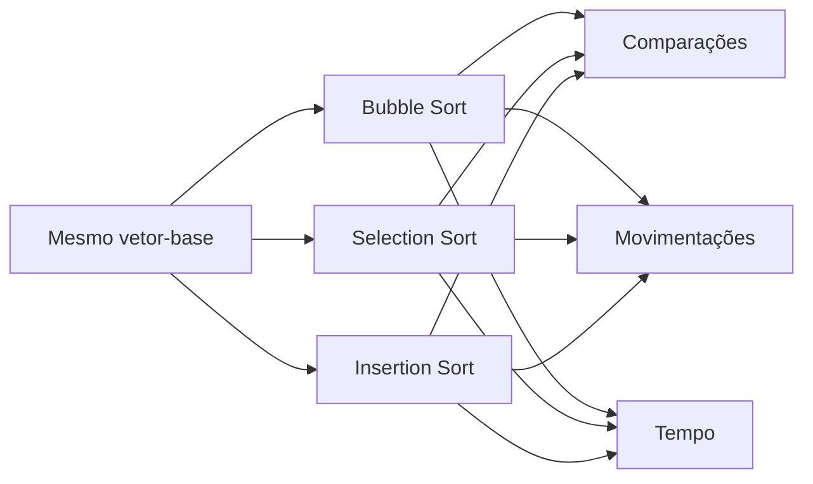

<div align="center">

# ⚔️ Batalha dos Algoritmos Quadráticos

**Bubble Sort vs. Selection Sort vs. Insertion Sort**

## 📌 Sobre o projeto

O projeto compara três algoritmos clássicos de ordenação quadrática usando cópias idênticas de um mesmo vetor. O foco é relacionar a análise teórica no **modelo RAM** com medições empíricas obtidas durante a execução.


## 🎯 Objetivos

- Implementar Bubble Sort, Selection Sort e Insertion Sort em C.
- Garantir que os três recebam exatamente a mesma entrada em cada cenário e repetição.
- Contabilizar comparações entre chaves e movimentações de elementos.
- Medir tempo de execução e exportar observações em CSV.
- Validar a ordenação e a preservação dos elementos.
- Comparar cenários aleatórios, ordenados, reversos e com valores repetidos.
- Relacionar resultados práticos às complexidades assintóticas.


### Algoritmos comparados

| Algoritmo | Melhor caso | Caso médio* | Pior caso | Escritas/trocas |
|---|---:|---:|---:|---|
| Bubble Sort otimizado | `O(n)` | `O(n²)` | `O(n²)` | Pode fazer muitas trocas |
| Selection Sort | `O(n²)` | `O(n²)` | `O(n²)` | No máximo `n - 1` trocas |
| Insertion Sort | `O(n)` | `O(n²)` | `O(n²)` | Desloca elementos e grava a chave |

\* Para entradas aleatórias, a ordem de crescimento do caso médio dos três é quadrática. O custo real depende da implementação, dos dados, do compilador e do hardware.




O script apresenta médias de comparações e movimentações, mediana do tempo e desvio-padrão populacional dos tempos registrados.

## 📏 O que é contado?

As métricas usam definições explícitas para tornar a comparação consistente:

| Métrica | Definição |
|---|---|
| `comparações` | Comparações entre valores do vetor, como `array[j] > key`. Comparações de controle de laço não entram na contagem. |
| `movementos` | Escritas de valores em posições do vetor. |
| Troca | Conta como três movimentações: temporário, primeira posição e segunda posição. |
| Deslocamento no Insertion Sort | Cada escrita de elemento deslocado conta como uma movimentação. |
| Gravação da chave | Cada gravação final da chave conta como uma movimentação. |
| `segundos` | Tempo de CPU medido com `relógio()` e reportado em segundos. |
| Validação | Verifica se o vetor está ordenado e se preserva os elementos da entrada. |

**Atenção:** movimentações são contadores definidos pelo programa; não equivalem a leituras/escritas físicas de RAM ou a contadores de hardware. A cópia inicial do vetor e a validação ficam fora da região cronometrada.

## 📊 Resultados experimentais

> **Não há números pré-preenchidos:** os resultados devem ser gerados no ambiente em que o benchmark for executado. Isso evita apresentar medições fictícias ou tempos obtidos em outra máquina como se fossem seus.

### Ambiente de execução da medição incluída

Os números abaixo foram coletados ao executar este projeto em um ambiente Linux de contêiner. Os tempos são referências desse ambiente e **não uma promessa de desempenho no computador de outra pessoa**.

| Item | Ambiente utilizado |
|---|---|
| Processador reportado pelo host | AMD EPYC 9V74 80-Core Processor |
| Sistema operacional / arquitetura | Linux 6.18.55, x86_64 |
| Compilador | GCC 14.2.0 |
| Flags de compilação | `-std=c11 -O2 -Wall -Wextra -Wpedantic` |
| Tamanho principal | `n = 5000` |
| Repetições por cenário | `7` |
| Semente | `20260901` |

### Resultados medidos — cenário aleatório, n = 5000

A tabela vem de `results/benchmark.csv`, produzido pelo executável e resumido por `scripts/analyze.py`. Os algoritmos receberam cópias idênticas do mesmo vetor-base em cada repetição. O tempo apresentado é a mediana das sete execuções.

| Algoritmo | Comparações médias | Movimentações médias | Tempo mediano (s) |
|---|---:|---:|---:|
| Bubble Sort | 12.497.035 | 18.933.033 | 0,061135 |
| Selection Sort | 12.497.500 | 14.985 | 0,030567 |
| Insertion Sort | 6.316.002 | 6.316.010 | 0,003390 |

### Resultados medidos — todos os cenários

| Cenário | Algoritmo | Comparações médias | Movimentações médias | Tempo mediano (s) |
|---|---|---:|---:|---:|
| Aleatório | Bubble Sort | 12.497.035 | 18.933.033 | 0,061135 |
| Aleatório | Selection Sort | 12.497.500 | 14.985 | 0,030567 |
| Aleatório | Insertion Sort | 6.316.002 | 6.316.010 | 0,003390 |
| Ordenado | Bubble Sort | 4.999 | 0 | 0,000005 |
| Ordenado | Selection Sort | 12.497.500 | 0 | 0,031383 |
| Ordenado | Insertion Sort | 4.999 | 4.999 | 0,000006 |
| Reverso | Bubble Sort | 12.497.500 | 37.492.500 | 0,121788 |
| Reverso | Selection Sort | 12.497.500 | 7.500 | 0,033357 |
| Reverso | Insertion Sort | 12.497.500 | 12.502.499 | 0,007079 |
| Com duplicatas | Bubble Sort | 12.437.469 | 17.447.193 | 0,058006 |
| Com duplicatas | Selection Sort | 12.497.500 | 14.100 | 0,029575 |
| Com duplicatas | Insertion Sort | 5.820.729 | 5.820.730 | 0,002815 |

Os tempos extremamente pequenos no cenário ordenado devem ser lidos com cautela: a resolução de `clock()` e a instrumentação influenciam medições tão curtas. O CSV contém todas as 84 execuções e os indicadores de validação.

### Interpretação dos resultados

- **Insertion Sort foi o mais rápido no cenário aleatório nesta medição**, com mediana de 0,003390 s. Ele fez cerca da metade das comparações do Bubble e do Selection, além de menos movimentações que o Bubble.
- **Bubble Sort fez mais escritas/movimentações** no cenário aleatório e, principalmente, no vetor reverso. Cada troca é contabilizada como três escritas, o que ajuda a explicar seu custo.
- **Selection Sort manteve quase o mesmo número de comparações em todos os cenários** (12.497.500 para `n = 5000`), mas realizou poucas movimentações porque só troca quando encontra um mínimo em posição diferente.
- **A classe `O(n²)` não determina sozinha o tempo real.** Constantes, padrões de acesso, número de escritas e comportamento dos dados afetam o resultado. Essas observações valem para esta implementação e este ambiente, não para todo computador.

### Como reproduzir

```bash
make clean && make
make test
./build/benchmark --n 5000 --repetitions 7 --seed 20260901 --output results/benchmark.csv
python3 scripts/analyze.py results/benchmark.csv
```

### Como interpretar

- **Comparações:** Selection Sort deve fazer aproximadamente `n(n-1)/2` comparações em todos os cenários, pois sempre procura o mínimo em cada região restante.
- **Movimentações:** Selection Sort tende a realizar muito menos trocas que Bubble Sort. Insertion Sort faz deslocamentos, cuja quantidade depende da ordem inicial.
- **Tempo:** a mediana reduz a influência de medições isoladas, mas não elimina interferências do sistema.
- **Cenário ordenado:** Bubble Sort otimizado e Insertion Sort podem executar em `O(n)`, enquanto Selection Sort continua em `O(n²)` comparações.
- **Cenário reverso:** Insertion Sort e Bubble Sort tendem a realizar muitas movimentações.
- **Valores repetidos:** ajudam a testar o comportamento quando várias chaves são iguais.

## 🔬 Análise teórica: por que os tempos diferem?

Todos os algoritmos têm pior caso `O(n²)`, mas isso não significa que executem o mesmo número de operações nem que cada operação tenha o mesmo custo na máquina.

- **Bubble Sort:** pode fazer muitas trocas adjacentes; cada troca é contabilizada como três escritas.
- **Selection Sort:** faz aproximadamente `n²/2` comparações, mas limita as trocas a `n - 1`.
- **Insertion Sort:** desloca valores e grava a chave, usando um laço interno simples e acessos a posições contíguas do vetor. Isso pode torná-lo competitivo apesar do crescimento quadrático médio.

Para `n = 5000`, `n² = 25.000.000` e `n(n-1)/2 = 12.497.500`. Esses números ilustram a escala dos termos quadráticos; não são tempos nem resultados medidos.

A conclusão deve combinar contagens, tempos e condições do experimento. **Insertion Sort pode ser mais rápido, mas não é garantido que vença em toda entrada, compilador ou hardware.

## 🧪 Metodologia e limitações

1. O vetor-base é gerado uma vez por cenário e repetição.
2. Cada algoritmo recebe uma cópia idêntica do vetor-base.
3. A ordem de execução dos algoritmos é rotacionada entre repetições para reduzir parcialmente o viés de ordem.
4. A validação é feita fora da região cronometrada.
5. Cada execução é gravada no CSV; a análise estatística é realizada posteriormente.
6. A instrumentação altera o código executado e pode afetar o tempo.
7. `Relógio()` tem resolução e semântica dependentes da plataforma. Para experimentos de alto rigor, considere um relógio monotônico específico do sistema operacional e documente a configuração.


